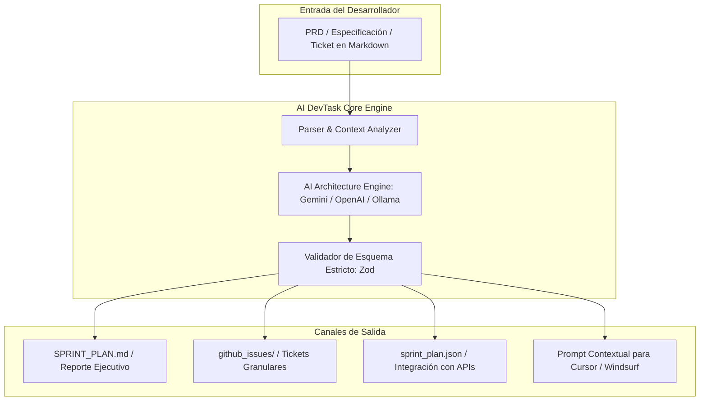

# AI DevTask Planner ⚡
### *Motor de Inteligencia Artificial para Desglose de Software, Arquitectura y Creación de Sprints*

[](https://www.typescriptlang.org/)
[](https://ai.google.dev/)
[](https://stream-arch.tech)
[](https://devtask.stream-arch.tech)
[](LICENSE)

> **Propuesta de Valor:** Transforma requerimientos vagos, PRDs o historias de usuario en un **Sprint Plan arquitectónico exhaustivo** en segundos: desglose de épicas y micro-tareas, estimaciones de esfuerzo, criterios de aceptación en formato Gherkin (*Given-When-Then*), sugerencia de archivos a modificar y exportación directa a GitHub Issues, Linear o Markdown.
>
> 🌐 **Landing & Simulador en Vivo:** [https://devtask.stream-arch.tech](https://devtask.stream-arch.tech)

---

## 🚀 Características Principales

* 🧠 **Arquitecto Virtual de Software:** Aplica principios de diseño SOLID, patrones limpios y análisis de dependencias técnicas antes de escribir una sola línea de código.
* 📋 **Criterios de Aceptación Gherkin:** Genera especificaciones ejecutables (`Given-When-Then`) listas para tests en Vitest, Jest o Playwright.
* 🛠️ **Preparador de Contexto para IDEs de IA:** Optimizado para alimentar prompts a Cursor, Windsurf, Claude Code y Copilot con los archivos sugeridos a editar.
* 📦 **Exportación Multi-Formato con 1 Clic:**
  * `SPRINT_PLAN.md`: Reporte ejecutivo en Markdown para Tech Leads y clientes.
  * `github_issues/`: Archivos individuales listos para ser creados como issues en repositorios.
  * `sprint_plan.json`: DTO estructurado con validación Zod en tiempo de ejecución.
* 🔌 **Multi-Proveedor de IA:** Soporte nativo para Google Gemini (1.5 Flash / 2.0 Flash), OpenAI (GPT-4o / mini), modelos locales vía Ollama (Llama 3 / Mistral con 100% privacidad) y motor Mock offline.
* 💳 **Pasarela de Licencias & Pagos:** Conector integrado con Lemon Squeezy (Merchant of Record) y generador criptográfico de licencias anti-tamper offline.

---

## 🏗️ Arquitectura del Sistema



---

## ⚡ Guía de Inicio Rápido (CLI)

### 1. Clonar e Instalar Dependencias
```bash
git clone https://github.com/TU_USUARIO/ai-devtask-planner.git
cd ai-devtask-planner
npm install
```

### 2. Ejecutar Demostración Inmediata (Modo Offline / Mock)
```bash
npm run demo
```
Esto procesa el archivo de prueba `examples/sample_prd.md` y genera la carpeta `output/` con el plan de sprint completo y los issues desglosados.

### 3. Planificar con Google Gemini API
```bash
# Configura tu API Key
set GEMINI_API_KEY=tu_api_key_aqui   # En Windows
export GEMINI_API_KEY=tu_api_key_aqui # En Linux/macOS

npm run dev -- plan mi_requerimiento.md -p gemini -m gemini-1.5-flash
```

### 4. Planificar con Modelos Locales (Ollama / Privacidad Total)
```bash
# Con Ollama activo en local
npm run dev -- plan mi_requerimiento.md -p ollama -m llama3
```

### 5. Compilar para Producción
```bash
npm run build
node dist/cli.js plan examples/sample_prd.md --provider mock
```

---

## 💻 Interfaz Web & Despliegue

La carpeta `landing/` contiene la aplicación web de autoservicio con:
* **Simulador interactivo en tiempo real** (prueba instantánea con prompts de ejemplo).
* **Calculadora interactiva de ROI** (demuestra el ahorro mensual en horas de ingeniería).
* **Portal de verificación de licencias criptográficas**.
* **Modal de checkout conectado a Lemon Squeezy**.

Desplegable con 1 clic en Vercel o Cloudflare Pages gracias al archivo `vercel.json` incluido.

---

## 📂 Estructura del Proyecto

```text
ai-task-planner/
├── landing/              # Web App y simulador interactivo de alta conversión
│   ├── index.html        # Landing page semántica y optimizada para SEO
│   ├── style.css         # Sistema de diseño dark-mode premium
│   └── app.js            # Lógica interactiva del simulador, ROI y modal
├── src/
│   ├── cli.ts            # CLI ejecutable con comandos 'plan', 'auth', 'checkout'
│   ├── server.ts         # Servidor API ligero para webhooks y licencias
│   ├── core/
│   │   ├── engine.ts     # Orquestador multi-modelo (Gemini, OpenAI, Ollama)
│   │   ├── prompts.ts    # Prompt maestro del Arquitecto de Software
│   │   ├── schema.ts     # Esquemas de validación con Zod
│   │   └── exporters/    # Generadores de Markdown, JSON y GitHub Issues
│   └── licensing/
│       ├── licenseManager.ts  # Firmas criptográficas HMAC y validación offline
│       └── paymentGateway.ts  # Conectores Lemon Squeezy, Stripe y Sandbox
├── examples/             # Ejemplos de PRDs y especificaciones técnicas
├── output/               # Directorio generado con sprints e issues exportados
└── vercel.json           # Configuración de despliegue en Vercel
```

---

## 📄 Licencia

Desarrollado bajo licencia MIT por **[Stream-Arch Tech](https://stream-arch.tech)**. Siéntete libre de utilizarlo, modificarlo y contribuir al ecosistema de herramientas de desarrollo asistidas por IA.
