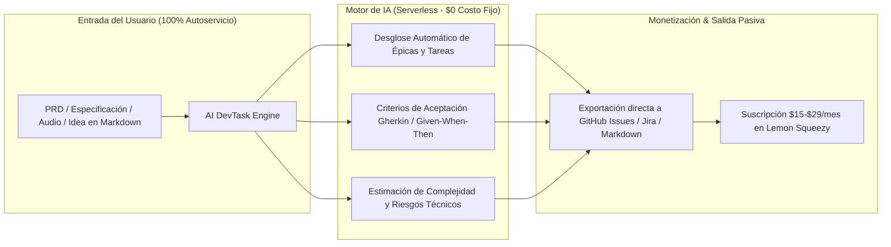
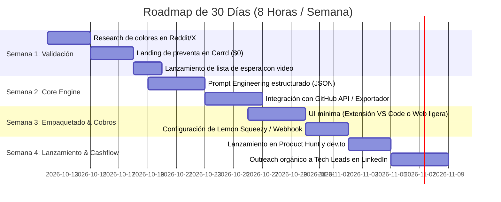

# EVALUACIÓN DE APALANCAMIENTO Y PLAN DE EJECUCIÓN
### *Caso de Estudio: IA para Movilidad vs. Planificador de Tareas de Software*

---

## 1. Matriz de Evaluación: Pasividad, Riesgo y Apalancamiento

Sometemos ambas ideas al filtro estricto de tus restricciones: **< $1,000 USD de capital**, **5 a 10 horas semanales** y **cero tolerancia a quiebras operativas**.

| Criterio de Evaluación | Idea A: Ecosistema de IA para Movilidad | Idea B: Planificador de Tareas de Software con IA |
| :--- | :--- | :--- |
| **Audiencia Objetivo** | Empresas de transporte, flotas, logística o municipios (B2B tradicional / B2G). | Desarrolladores, Tech Leads, Agencias de Software y Startups (B2D / B2B SaaS). |
| **Ciclo de Venta** | **Lento (3 a 9 meses):** Requiere reuniones, demos presenciales/virtuales y contratos personalizados. | **Inmediato (Minutos):** Autoservicio (*Product-Led Growth*). El usuario prueba, ve el valor y pasa su tarjeta. |
| **Carga de Soporte al Cliente** | **Muy Alta:** Incidencias de flotas en tiempo real, SLAs críticos, telemetría y hardware. | **Baja / Nula:** Herramienta asíncrona. Si está bien documentada y tiene manejo de errores, opera sola. |
| **Costos de Infraestructura** | Medios a Altos (procesamiento masivo de geodatos en tiempo real). | Prácticamente $0 (arquitectura serverless + Bring-Your-Own-Key o créditos de API). |
| **Apalancamiento de tu Tiempo (5-10h/sem)** | **Bajo (3/10):** Te obligaría a responder chats de emergencia y dar consultoría activa. | **Extremo (9.5/10):** Se programa una sola vez; entrega valor a cientos de desarrolladores en paralelo. |
| **Potencial de Ingreso Pasivo Real** | Muy difícil de hacer pasivo en etapa temprana. | **Ideal para Micro-SaaS o Herramienta de Pago Único / Recurrente.** |

---

## 2. Veredicto Estratégico

> ### **El Ganador Inmediato para Ingreso Pasivo: Idea B (Planificador de Tareas de Software con IA)**
> **Razón:** Los desarrolladores y equipos técnicos ya tienen presupuestos asignados para herramientas de productividad y sufren un dolor agudo: el tiempo perdido desglosando historias de usuario, estimando esfuerzos y creando tickets en Jira/GitHub/Linear.
> 
> *¿Qué hacemos con la Idea A (Movilidad)?* No la descartamos, pero la convertimos en un **Activo Digital de Código Especializado (Modelo 1)** en lugar de intentar venderla como empresa de logística.

---

## 3. Arquitectura del Producto Ganador: "AI DevTask Engine"

Para que este software te genere ingresos sin quitarte tiempo de tu trabajo principal, debe diseñarse con la regla de **"Cero Fricción Humana"**:



### Formato de Implementación de Máximo Apalancamiento:
En lugar de crear una plataforma web compleja desde cero con cientos de pantallas, elige uno de estos dos formatos ultraligeros:

1. **Opción 1: Extensión de VS Code o Plugin de Cursor (Recomendada):**
   * El desarrollador tiene su código y su archivo `PRD.md` o `spec.txt` abierto en su editor.
   * Con un comando (`Ctrl+Shift+P` -> *Generate Sprint Tasks*), la extensión analiza el contexto del proyecto y desglosa las tareas con archivos a modificar y comandos a correr.
   * Monetización: 10 consultas gratis; luego suscripción de **$12 USD/mes** o licencia anual de **$79 USD**.

2. **Opción 2: Web App Ultraligera conectada a GitHub / Linear:**
   * El Tech Lead pega el link de su issue o PRD.
   * La app genera todo el árbol de tareas y crea automáticamente los issues en el repositorio de GitHub con un clic.
   * Monetización: **$19 a $39 USD/mes por equipo**.

---

## 4. Cómo Monetizar la Idea A (Movilidad) sin Esfuerzo Operativo

Si ya tienes algoritmos o pipelines desarrollados para movilidad e IA (ej. ruteo, predicción de demanda, despacho de vehículos, análisis de flotas):
* **No vendas servicio a empresas de transporte:** Te costará meses de reuniones de ventas y soporte 24/7.
* **Empaquétalo como un "AI Mobility Starter Kit / API Wrapper":**
  * Súbelo a Lemon Squeezy y GitHub como un paquete listo para producción (ej. *Python + FastAPI Boilerplate para Optimización de Rutas y Agentes de Despacho con IA*).
  * Precio: **$99 a $199 USD (pago único)**.
  * Compradores: Startups de logística que quieren ahorrarse 100 horas de programación.
  * Tu tiempo requerido una vez publicado: **0 horas semanales**.

---

## 5. Plan de Ejecución Táctico de 30 Días para el Planificador de Tareas

Distribución calculada exactamente para tus **7 a 8 horas semanales**:



### Detalle de Tareas por Semana:

#### Semana 1: Validación y Demanda Real (Inversión: 7 horas | Costo: $0 USD)
* **Objetivo:** Conseguir 20 personas interesadas o 3 preventas antes de escribir código pesado.
* **Acción:**
  * Grabar un demo simulado de 90 segundos mostrando el flujo: *"Pegas un requerimiento -> IA genera el desglose de 8 tareas con dependencias y criterios de aceptación listos para GitHub"*.
  * Publicar en comunidades como `r/webdev`, `r/programming`, X (#buildinpublic) y LinkedIn.
  * Añadir enlace a una landing gratuita con opción de acceso anticipado con 50% de descuento.

#### Semana 2: Construcción del Motor Central (Inversión: 8 horas | Costo: $0 USD)
* **Objetivo:** Un pipeline en TypeScript/Python que reciba un texto y devuelva un esquema JSON estricto:
  ```json
  {
    "epic_title": "Sistema de Autenticación",
    "tasks": [
      {
        "title": "Implementar middleware de JWT",
        "estimate_hours": 3,
        "acceptance_criteria": ["Debe validar tokens expirados", "Retornar 401 si falta header"],
        "suggested_files": ["src/middleware/auth.ts"]
      }
    ]
  }
  ```
* Se prueba localmente con modelos eficientes (Gemini 1.5 Flash / Claude Haiku / GPT-4o-mini).

#### Semana 3: Pasarela de Pago y Experiencia de Usuario (Inversión: 7 horas)
* Conectar Lemon Squeezy con generación de clave de licencia (License Key API).
* Implementar verificación de licencia automática en el cliente.
* Crear documentación en 1 sola página con capturas de pantalla.

#### Semana 4: Distribución y Primeros Clientes (Inversión: 8 horas)
* Publicación en directorios de herramientas de IA (*Futurepedia*, *There's An AI For That*, *Product Hunt*).
* Compartir el proceso y aprendizajes en artículos técnicos breves (en dev.to y Medium), enlazando directamente al producto.

---

## 6. Proyección Financiera Conservadora a 12 Meses

Calculado con un precio accesible de **$15 USD/mes (o $99 USD/año)**:

* **Mes 1:** Lanzamiento inicial -> 5 clientes de preventa = **$75 USD/mes**.
* **Mes 3:** Tráfico orgánico de extensiones / directorios -> 25 clientes = **$375 USD/mes**.
* **Mes 6:** 60 clientes activos = **$900 USD/mes**.
* **Mes 12:** 120 clientes activos = **$1,800 USD/mes de MRR**.

**Rendimiento Operativo:**
* Gastos de servidores: < $25 USD/mes.
* Horas requeridas de mantenimiento: 2 a 3 horas semanales.
* **Margen Neto:** > 95%.
* **Destino de los fondos:** Aplicar la **Regla 70/30** del sistema operativo (70% a inversión patrimonial pasiva, 30% a reinversión).
