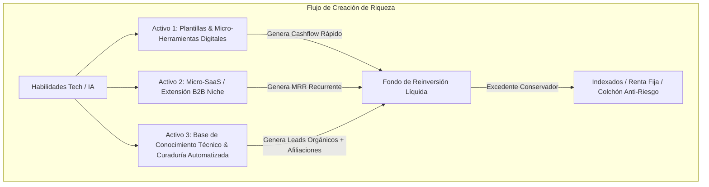
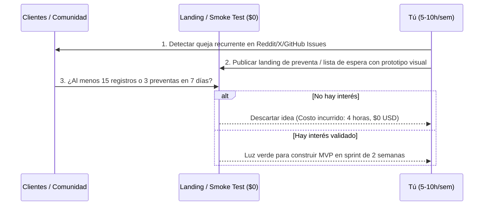

# SISTEMA OPERATIVO DE INGRESOS PASIVOS & SEMI-PASIVOS (SO-IP)
### *Framework Estratégico de Apalancamiento Digital para Ingenieros y Creadores Tech*

---

## 1. Diagnóstico de Perfil y Ecuación de Apalancamiento

| Variable | Estado del Perfil | Implicación Estratégica |
| :--- | :--- | :--- |
| **Capital Inicial** | `< $1,000 USD` | Prohibido quemar dinero en pauta pagada o inventario físico. Enfoque 100% en **activos digitales sin coste marginal**. |
| **Tiempo Disponible**| `5 a 10 h / semana` | Debe evitarse cualquier modelo que requiera atención al cliente sincrónica o consultoría tradicional. Enfoque en **arquitectura asíncrona y automatización**. |
| **Habilidad Núcleo**| **Tecnología / Software / IA** | Mayor ventaja competitiva del mercado: capacidad de crear herramientas, scripts, pipelines y productos de software que funcionan 24/7 sin coste laboral. |
| **Perfil de Riesgo** | **Conservador** | Cero riesgo de quiebra financiera. El único costo es tiempo estructurado en bloques protegidos. |

### El Principio Rector: *Apalancamiento sin Permiso (Permissionless Leverage)*
Siguiendo el marco de Naval Ravikant, existen cuatro formas de apalancamiento: mano de obra, capital, código y medios. Dado tu capital limitado y tiempo acotado:
> **Tu palanca es el Código y los Activos Digitales:** Se programan una sola vez y se replican millones de veces a coste marginal cero, generando flujo de caja sin supervisión humana.

---

## 2. Los 3 Modelos de Negocio Validados (Flujo de Caja Concurrente)

---

### MODELO 1: Activos Digitales de Código & Automatizaciones de IA (Cashflow Rápido)
* **Naturaleza:** 100% Pasivo tras publicación.
* **Qué es:** Venta de soluciones listas para usar dirigidas a otros desarrolladores, agencias o no-programadores:
  1. **Boilerplates / Starters especializados:** (ej. template de micro-SaaS con Next.js + Stripe + Auth preconfigurado para agentes autónomos).
  2. **Pipelines / Flujos de Automatización empaquetados:** Flujos avanzados en Make/n8n/Python para scraping estructurado, enriquecimiento de CRM o pipelines RAG llave en mano.
* **Canales de Venta:** Lemon Squeezy, Gumroad, GitHub Sponsors, Envato / Product Hunt.
* **Unit Economics:**
  * Precio: $29 - $79 USD (pago único con updates anuales opcionales).
  * 15 a 30 ventas/mes = **$500 a $1,800 USD/mes netos**.
  * Costo operativo: $0 USD (alojado en GitHub/Gumroad).

---

### MODELO 2: Micro-SaaS / B2B Utility Plugin (Ingreso Recurrente - MRR)
* **Naturaleza:** Semi-pasivo (mantenimiento de 1 a 2 horas semanales).
* **Qué es:** Herramienta hiperespecífica que resuelve un solo dolor en un ecosistema existente con tráfico cautivo:
  * Extensiones de Chrome para profesionales (ej. exportador de leads de LinkedIn a Sheets con IA, auditor de accesibilidad web, extractor de prompts).
  * Integración en Marketplace de Shopify, Notion, Figma o Jira.
* **Por qué funciona para ti:**
  * No necesitas construir una app completa con infraestructura pesada. Te apalancas en el marketplace oficial (Google Chrome Web Store / Shopify Store) que ya tiene millones de compradores.
* **Unit Economics:**
  * Modelo freemium: plan gratuito limitado, plan Pro a **$9 - $19 USD/mes**.
  * Con 80 usuarios de pago = **~$1,000 USD MRR recurrente y predecible**.
  * Stack gratuito/casi cero costo: Cloudflare Workers / Supabase / Vercel Free Tier.

---

### MODELO 3: Publicación Técnica & Sistema de Afiliación de APIs / Infraestructura
* **Naturaleza:** Semi-pasivo (generador de demanda orgánica para los Modelos 1 y 2).
* **Qué es:** Documentación pública, comparativas de APIs y tutoriales paso a paso de IA (en formato blog / newsletter / GitHub Awesome-List).
* **Monetización Pasiva:**
  * Programas de referidos de infraestructura (Vercel, Supabase, DigitalOcean, OpenAI credits, Modal, Replicate).
  * Patrocinios en newsletter (a partir de 1,000 suscriptores técnicos: $100-$250 por mención).

---

## 3. Protocolo de Validación en 3 Pasos (Cero Desperdicio de Capital)

Antes de escribir una sola línea de código en un proyecto largo, aplicamos el **Filtro Anti-Fricción**:

1. **Investigación de Demanda Inelástica:**
   * Buscar en subreddits (`r/SaaS`, `r/webdev`, `r/Automate`), comunidades de Discord y foros de herramientas dolores que la gente resuelva manualmente perdiendo horas cada semana.
2. **Smoke Test (Prueba de Humo):**
   * Crear una página de aterrizaje con Carrd o Framer (plan gratuito).
   * Añadir un botón "Comprar preventa con 50% de descuento" conectado a LemonSqueezy en modo de prueba. Si la persona hace clic, demuestra intención real de pago.
3. **Regla de Oro:** Si no hay al menos 3 personas dispuestas a pagar o 25 esperando el lanzamiento, se itera la oferta sin haber perdido capital.

---

## 4. Arquitectura de Automatización y Stack Tecnológico de $0 Costo

Para operar con 5 a 10 horas semanales sin que el soporte al cliente te sature:

| Componente | Herramienta Recomendada | Costo Mensual |
| :--- | :--- | :--- |
| **Hosting & Cómputo** | Cloudflare Pages / Workers + Vercel Hobby | $0.00 |
| **Base de Datos** | Supabase (Tier gratuito: 500MB DB + Auth) | $0.00 |
| **Pasarela de Pagos** | Lemon Squeezy (actúa como *Merchant of Record*, maneja impuestos de IVA/VAT globalmente de forma pasiva) | Solo comisión por venta |
| **Documentación & Soporte** | Mintlify o GitBook + FAQ interactiva estructurada | $0.00 |
| **Automatización Interna** | n8n (self-hosted o cloud free tier) / GitHub Actions | $0.00 |

---

## 5. Cronograma Semanal Operativo (Presupuesto: 7 Horas/Semana)

Para compatibilizar este sistema con tu trabajo full-time y evitar el agotamiento:

* **Lunes (1 h - 20:30 a 21:30):** Métricas, revisión de ventas y triage de soporte automatizado.
* **Miércoles (1.5 h - 20:30 a 22:00):** Desarrollo enfocado (sprint de producto / mejora de micro-SaaS).
* **Viernes (1.5 h - 20:30 a 22:00):** Desarrollo y testing de producto.
* **Sábado mañana (3 h - 08:30 a 11:30):** Bloque creativo: documentación, marketing orgánico (posts en X/LinkedIn/Reddit mostrando el proceso *build in public*).
* **Domingo:** **Descanso absoluto.**

---

## 6. Hoja de Ruta Táctica de 90 Días

### Fase 1 (Días 1 a 30): Construcción del Activo Rápido (Modelo 1)
* **Semana 1:** Identificar tu mejor framework o script interno que ya usas en tu día a día (ej. pipeline de IA, boilerplate de Next.js, script de scraping ético).
* **Semana 2:** Empaquetarlo con documentación impecable (README, variables de entorno, video demo de 3 min en Loom).
* **Semana 3:** Configurar storefront en Lemon Squeezy y preparar kit de lanzamiento.
* **Semana 4:** Lanzamiento en Product Hunt, comunidades de Reddit especializadas y GitHub. Meta: Primeras 5 a 10 ventas ($250 - $500 USD).

### Fase 2 (Días 31 a 60): Selección y Validación de Micro-SaaS (Modelo 2)
* **Semanas 5-6:** Validar una extensión o plugin B2B con la prueba de humo.
* **Semanas 7-8:** Desarrollar el MVP de alcance mínimo (máximo 20 horas de programación total).

### Fase 3 (Días 61 a 90): Despliegue, MRR y Bucle de Reinversión
* **Semanas 9-10:** Publicación en el Chrome Web Store o Marketplace correspondiente.
* **Semanas 11-12:** Activación de embudo de retención. Configuración del flujo de reinversión patrimonial conservador.

---

## 7. Política Financiera y Gestión del Capital

1. **Separación de Cuentas:** Crear una cuenta bancaria digital (Wise / Payoneer / cuenta dedicada) donde aterricen los ingresos de Lemon Squeezy / Stripe.
2. **Regla de Distribución de Ganancias (Fórmula 70/30):**
   * **70% al Portafolio Patrimonial Conservador:** Fondos indexados globales (ej. Vanguard All-World ETF / S&P 500) o depósitos a plazo de alto rendimiento para generar interés compuesto pasivo tradicional.
   * **30% Fondo de Oportunidad Digital:** Para reinvertir en dominios, herramientas pro que ahorren tiempo o micro-adquisiciones.
3. **Cero Endeudamiento:** Este sistema nunca toma deuda para financiar crecimiento; solo reinvierte flujo de caja validado.
